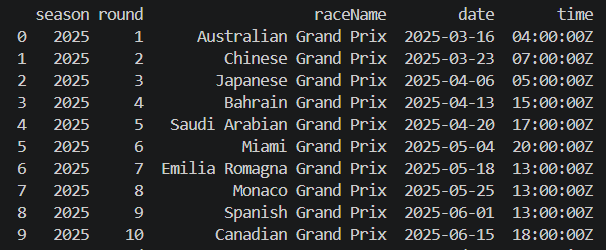

# Сбор данных через API

Данные получены из публичного API: https://api.jolpi.ca/ergast/f1/2025/races/.
Jolpica F1 API предоставляет структурированные данные о Formula 1: сезонах, этапах, гонках, трассах, пилотах, командах и результатах. В этой работе используется календарь гонок сезона 2025 года.

Скрипт `read_api.py` отправляет GET-запрос к API и получает календарь гонок Formula 1 за сезон 2025 года.

Из ответа API формируется датасет со следующими полями:

- `season` — сезон;
- `round` — номер этапа;
- `raceName` — название гонки;
- `date` — дата проведения;
- `time` — время старта.

Полученный датасет сохраняется в файл `data/f1_races_2025.csv`.

## Пример данных

Ниже приведены первые строки полученного датасета.

